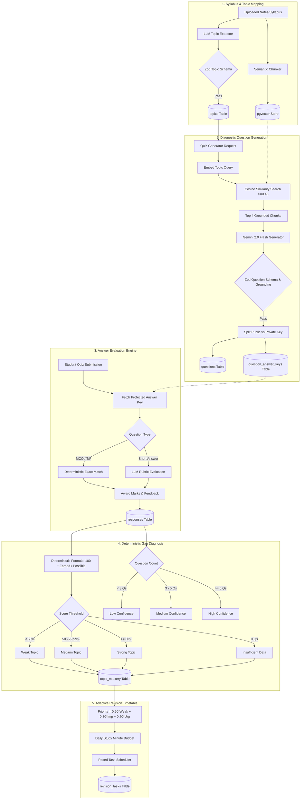

# GapFinder AI — End-to-End AI Workflow Specification

## 1. End-to-End Workflow Diagram



---

## 2. Deterministic vs. LLM-Based Component Breakdown

To guarantee complete auditability, academic integrity, and reproducibility, GapFinder AI strictly isolates non-deterministic LLM operations from deterministic calculations:

| Component | Nature | Implementation & Responsibility |
| :--- | :--- | :--- |
| **Topic Hierarchy Extraction** | **LLM-Based (Constrained)** | Gemini 2.0 Flash extracts module names, subtopics, and estimated study times, validated against a strict Zod schema. |
| **Diagnostic Question Creation** | **LLM-Based (Grounded)** | Questions are generated strictly using retrieved context chunks. Zod validation verifies difficulty, marks, options, and explanations. |
| **Objective Answer Scoring** | **Deterministic** | MCQs and True/False questions are graded using direct server-side string equality or index comparison against isolated answer keys. |
| **Short-Answer Grading** | **Hybrid (LLM + Bounds Check)** | Gemini evaluates conceptual understanding using a pre-generated rubric, but marks are deterministically bounded: $0 \le \text{awarded\_marks} \le \text{maximum\_marks}$. |
| **Topic Mastery Calculation** | **Purely Deterministic** | Calculated mathematically from actual persisted quiz responses. No LLM estimation or hallucinated scores. |
| **Confidence Level Heuristic** | **Purely Deterministic** | Explicit threshold rules based on assessed question volume ($<3$: Low, $3-5$: Medium, $\ge 6$: High). |
| **Revision Task Priority** | **Purely Deterministic** | Weighted sum: $0.50 \times \text{Weakness} + 0.30 \times \text{Importance} + 0.20 \times \text{Urgency}$. |
| **Timetable Daily Allocation** | **Purely Deterministic** | Greedy calendar bin-packing respecting student's daily study minutes and exam deadline. |

---

## 3. Grounding Verification & Anti-Hallucination Controls

1. **Context Boundary Isolation**:
   Retrieved chunks are passed to the generator within explicit non-executable XML delimiters:
   ```text
   <STUDY_MATERIAL_CONTEXT>
   [Chunk ID: chunk-123 | Source: Lecture 04, Page 12]
   Gradient descent minimizes the cost function J(theta) by updating parameters in the opposite direction of the gradient...
   </STUDY_MATERIAL_CONTEXT>
   ```
2. **Chunk ID Cross-Validation**:
   The generator prompt commands:
   > "Generate questions derived EXCLUSIVELY from the text in <STUDY_MATERIAL_CONTEXT>. Every question MUST cite one or more valid Chunk IDs present in the context. Never cite a Chunk ID that was not provided."
   At runtime, `src/lib/ai/question-generator.ts` checks that `question.source_references[].chunk_id` exists in the set of retrieved chunk IDs. Questions failing this test are rejected.
3. **Refusal on Insufficient Evidence**:
   If vector retrieval returns chunks with cosine similarity below $0.45$, question generation for that topic is aborted with an honest warning: `"Insufficient material uploaded to generate a grounded quiz for this topic."`

---

## 4. Mathematical Specifications

### 4.1 Topic Mastery Score
$$\text{Mastery Score} = 100 \times \frac{\sum_{i=1}^{N} \left(\text{Awarded Marks}_i \times w_i\right)}{\sum_{i=1}^{N} \left(\text{Possible Marks}_i \times w_i\right)}$$
Where $w_i$ is the difficulty weight:
- Easy: $w = 1.0$
- Medium: $w = 1.25$
- Hard: $w = 1.5$

### 4.2 Status Classification
$$\text{Status} = \begin{cases} 
\text{insufficient\_data} & \text{if } N = 0 \\
\text{weak} & \text{if } \text{Mastery Score} < 50.0 \\
\text{medium} & \text{if } 50.0 \le \text{Mastery Score} < 80.0 \\
\text{strong} & \text{if } \text{Mastery Score} \ge 80.0
\end{cases}$$

### 4.3 Revision Task Priority Heuristic
$$\text{Priority} = 0.50 \times (100 - \text{Mastery Score}) + 0.30 \times (\text{Importance} \times 20) + 0.20 \times \text{Urgency}$$
Where:
- $\text{Importance} \in [1, 5] \implies \text{Normalized to } [20, 100]$
- $\text{Urgency} = \max\left(0, 100 - \frac{\text{Days Until Exam}}{30} \times 100\right)$
