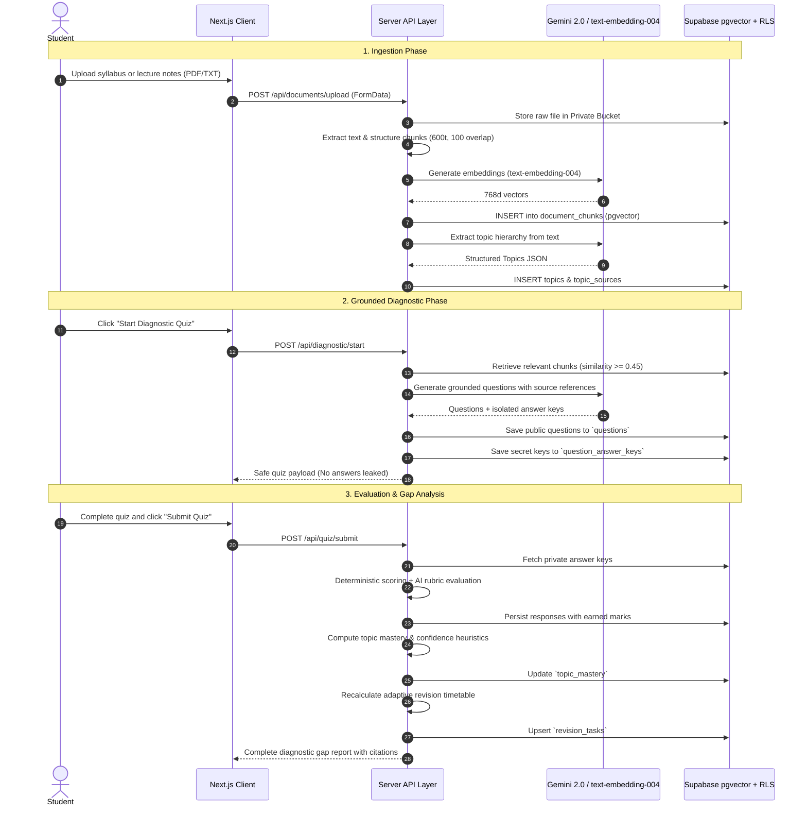

# GapFinder AI — System Architecture

## 1. System Overview

**GapFinder AI** is built as an end-to-end, production-grade personalized learning diagnosis and adaptive revision platform. Unlike generic PDF chatbots that merely answer free-form student queries, GapFinder AI systematically extracts a structured topic hierarchy from uploaded course materials, generates grounded diagnostic quizzes, securely isolates correct answer keys, deterministically scores learning gaps, and generates a time-aware daily revision schedule.

```mermaid
graph TD
    subgraph ClientLayer ["Client Layer (Next.js 16 + React 19)"]
        LandingPage["Landing & Marketing (/)"]
        AuthPages["Auth Flows (/login, /signup, /onboarding)"]
        Dashboard["Student Dashboard (/dashboard)"]
        MaterialsUI["Document Management (/materials, /materials/[id])"]
        TopicMapUI["Syllabus & Topic Explorer (/topics)"]
        QuizEngine["Diagnostic Engine (/diagnostic, /quiz/[id], /results/[id])"]
        GapReportUI["Diagnostic Gap Report (/gap-report)"]
        RevisionPlanUI["Adaptive Calendar (/revision-plan)"]
        TopicAssistantUI["Grounded Tutor Assistant (/assistant)"]
    end

    subgraph ServiceLayer ["Next.js Server Layer (API Routes & Server Actions)"]
        AuthMiddleware["Supabase Auth Session & RLS Validation"]
        IngestionService["Document Extraction & Ingestion Service"]
        ChunkingEngine["Semantic Chunking & Metadata Engine"]
        EmbeddingService["Vector Embedding Service (768d)"]
        RetrievalService["pgvector Cosine Retrieval & Citation Engine"]
        QuestionGenService["Grounded Question Generator (Zod Validated)"]
        AnswerEvalService["Hybrid Evaluator (Exact + AI Rubric)"]
        GapAnalysisEngine["Deterministic Gap Diagnosis Service"]
        RevisionPlanner["Constrained Timetable Planner"]
    end

    subgraph DatabaseLayer ["Supabase PostgreSQL + pgvector + Storage"]
        AuthUsers["auth.users (Identity)"]
        StudentProfiles["profiles (Display, Onboarding)"]
        Subjects["subjects & topics (Syllabus Hierarchy)"]
        Documents["documents & document_chunks (pgvector 768d)"]
        QuizStore["quiz_attempts & questions"]
        SecureKeys["question_answer_keys (Isolated Answers)"]
        Responses["responses (Evaluations & Feedback)"]
        MasteryStore["topic_mastery (Aggregated Diagnostics)"]
        TaskSchedule["revision_tasks (Paced Daily Tasks)"]
        ChatStore["chat_sessions & chat_messages"]
        PrivateBucket["Supabase Private Storage (PDF/TXT)"]
    end

    subgraph ExternalAI ["Google Gen AI (Gemini)"]
        GeminiFlash["Gemini 2.0 Flash (Structured Output & Grading)"]
        GeminiEmbed["text-embedding-004 (768 Dimensions)"]
    end

    ClientLayer --> ServiceLayer
    ServiceLayer --> DatabaseLayer
    ServiceLayer --> ExternalAI
```

---

## 2. Component Responsibilities

### 2.1 Frontend Client Layer
- **App Shell & State Management**: Responsive sidebar shell (`src/components/ui/AppShell.tsx`) providing persistent subject context, mobile navigation drawer, and active route indication.
- **Accessible Design System**: Built with modern typography, semantic colors (Red `#DC2626` for Weak, Amber `#D97706` for Medium, Green `#16A34A` for Strong, Slate `#64748B` for Insufficient Data), accessible progress meters (`MasteryMeter.tsx`), and citation inspection drawers (`CitationDrawer.tsx`).
- **Interactive Exam Simulator**: Safe active quiz runner (`src/app/quiz/[attemptId]/page.tsx`) with paginated navigation, answer selection persistence, auto-save state, unanswered counters, and double-confirmation submission.
- **Visual Analytics**: Interactive Recharts displays (`src/app/progress/page.tsx`) rendering authentic score trends, mastery distribution, and topic bar comparisons without synthetic placeholder data points.

### 2.2 Next.js Server & AI Service Layer
- **`src/lib/ai/provider.ts`**: Official `@google/genai` client initialization with model fallback, JSON schema-enforced structured generation, and runtime type extraction.
- **`src/lib/ai/chunking.ts`**: Structural document parser detecting Markdown headings (`#`, `##`), uppercase chapter labels, and paragraph boundaries to create 600-token chunks with 100-token sliding overlap.
- **`src/lib/ai/embeddings.ts`**: Batched vector embedding generation using `text-embedding-004` returning 768-dimensional float arrays.
- **`src/lib/ai/retrieval.ts`**: Authenticated pgvector cosine similarity search (`match_document_chunks`) strictly filtered by `user_id` and `subject_id`, with similarity gating (threshold $\ge 0.45$).
- **`src/lib/ai/question-generator.ts`**: Grounded diagnostic quiz generator validating cited chunk IDs against retrieved evidence and isolating answer keys in a server-protected table.
- **`src/lib/ai/answer-evaluator.ts`**: Deterministic exact/normalized string matching for objective MCQs, combined with LLM rubric evaluation for subjective short-answer responses.
- **`src/lib/ai/gap-analysis.ts`**: Fully deterministic, mathematical topic diagnosis calculating:
  $$\text{Mastery Score} = 100 \times \frac{\sum \text{Earned Marks} \times \text{Difficulty Weight}}{\sum \text{Possible Marks} \times \text{Difficulty Weight}}$$
- **`src/lib/ai/revision-planner.ts`**: Time-constrained heuristic scheduler pacing revision tasks across remaining exam days while respecting student daily study minute caps.

---

## 3. Data Flow

---

## 4. Security Architecture & Boundaries

1. **Strict Client-Server Isolation**:
   - Zero LLM prompt templates or raw Gemini API keys are accessible in client JavaScript bundles.
   - Database operations run either under authenticated user sessions respecting Postgres Row Level Security (RLS) or via server-only administrative clients for atomic system background jobs.
2. **Answer Key Protection (`question_answer_keys`)**:
   - Correct answers, options keys, and grading rubrics are physically partitioned into the `question_answer_keys` table.
   - The public `/api/quiz/[attemptId]` endpoint verifies the quiz status; while `in_progress`, explanation and answer keys are never delivered to the browser.
3. **Prompt Injection & Untrusted Data Quarantine**:
   - Uploaded student notes and textbook extracts are treated strictly as **passive data** inside delimiter blocks (`--- CONTEXT CHUNKS ---`).
   - System prompts enforce that instructions found within uploaded text files must never override the evaluator or generator rules.
4. **Tenant Isolation via PostgreSQL RLS**:
   - Every domain table (`documents`, `document_chunks`, `topics`, `quiz_attempts`, `responses`, `topic_mastery`, `revision_tasks`) enforces `auth.uid() = user_id`.
   - Vector similarity RPC search (`match_document_chunks`) strictly enforces `c.user_id = filter_user_id`.
